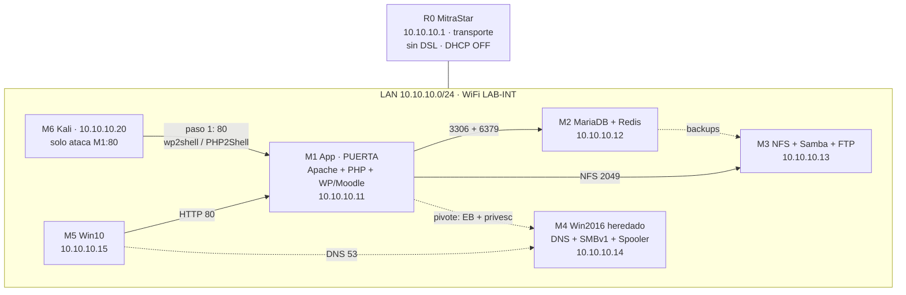

# Infraestructura universitaria vulnerable — v4.1 (red plana + separación lógica)

**M1 app · M2 base de datos · M3 respaldos · M4 Windows heredado · M5 cliente · M6 Kali (misma LAN, con disciplina + FW)**

- **Versión:** 4.1 (red plana: solo MitraStar + separación lógica por firewall de host)
- **Guía de referencia:** `Guía_Trabajo_Final (1).pdf` (IS-1023, UNAM/EPISI, Semana 07)
- **Red:** LAN única `10.10.10.0/24` en WiFi `LAB-INT` (M1–M6, bridge VMware, DHCP OFF, sin DSL)
- **Router R0:** MitraStar DSL-2401HN-T1C como `10.10.10.1` (solo transporte; el control lo hace el FW de cada VM)
- **Modelo:** Kali en `10.10.10.20` (misma LAN, §6 guía) con disciplina + FW: solo ataca M1:80/443 hasta el pivote
- **Diagrama editable:** [`arquitectura-universitaria.drawio`](./arquitectura-universitaria.drawio)
- **Vista previa:** [`arquitectura-universitaria.png`](./arquitectura-universitaria.png) · [`arquitectura-universitaria.svg`](./arquitectura-universitaria.svg)
- **Guías por máquina:** [`guias/`](./guias/) (una por estudiante + router + base VMware)
- **Casos estrella:** **wp2shell** (CVE-2026-63030, WordPress Core, KEV) + **PHP2Shell** (CVE-2026-109618 / CVE-2026-109619)

---

## 1. Qué cambió respecto a la v2 (y por qué)

La v2 era técnicamente rica (AD DS, IIS, pools, Prometheus, Docker) pero **cara de montar y de vulnerar** para 6 estudiantes con una VM cada uno. La guía exige otra cosa: roles fijos por máquina, ≥3 vulns por equipo, privesc en M4 y encadenamiento hasta llegar a todo. La v3 volvió a lo básico; la **v4 añade el modelo de red realista**: Kali fuera, una sola puerta (el web) y pivoteo interno.

| v2 | v3 (esta versión) | Motivo |
|---|---|---|
| Web en M4 (IIS + AD DS) | Web en **M1** (Apache + PHP) | La guía fija la aplicación en M1 (Fase 1) |
| AD DS + DNS integrado | DNS **standalone** en M4, sin dominio | Menos piezas, mismo servicio de nombres |
| M1 observabilidad (Prometheus/Grafana/Docker) | M1 solo aplicación | Cada VM un rol; observabilidad pasa a anexo opcional |
| Storage por SMB + mapeos Windows | Storage por **NFS** (Linux↔Linux) + Samba/vsftpd vulnerables | NFS es el montaje simple; Samba/vsftpd aportan los CVE de M3 |
| M5 Ubuntu unido al dominio | M5 **Windows 10** en workgroup | El catálogo de la guía pide BlueKeep/EternalBlue en M5 |
| PHP 8.3.35 en IIS FastCGI | PHP **8.4.26 mod_php** en M1 | SAPI con PoC público confirmado para PHP2Shell |

> Nada de la v2 se pierde: AD, IIS, Prometheus y Docker quedan como **anexo de variantes avanzadas** si sobra tiempo. El núcleo evaluable es esta v3.

---

## 2. Mapeo guía → este documento

| Requisito de la guía | Dónde se cubre aquí |
|---|---|
| §5 arquitectura + direccionamiento | §4 inventario, §5 red, diagrama `.drawio` |
| §6 roles por máquina | §3 tabla de roles y responsables |
| Fase 0 snapshots inicial/parcheado | §12 registro de instantáneas |
| Fase 1 montaje (app M1, DB M2, respaldos M3, red M4) | §9 runbooks mínimos |
| Fase 2 ≥3 vulns por máquina + privesc M4 | §7 plan maestro + §8 fichas |
| §9 fuentes oficiales + verificación en NVD | §7 tabla con enlace NVD por CVE |
| §10 catálogo (incl. CVSS 10) | §7 (Redis CVE-2022-0543, 10.0) |
| Fases 3–4 recon/validación | §10 auditoría desde M6 |
| Fases 5–6 remediación + antes/después | §11 tabla de remediación |
| §11 estructura del informe | §13 correspondencia sección por sección |
| §12 réplica en vivo + diapositiva previa | §13.2 guion de réplica |
| §14 ética y aislamiento | §12.3 reglas obligatorias |
| §15 evaluación (criticidad, alcance, profundidad) | §2.1 estrategia de puntaje |

### 2.1 Estrategia de puntaje (§15 de la guía)

1. **Criticidad máxima:** Redis **CVE-2022-0543 (10.0)** + dos RCE recientes con explotación activa (wp2shell en KEV, PHP2Shell en campo).
2. **Alcance total:** la cadena §6.2 llega a las 6 máquinas (M6 es el atacante; M1–M5 caen).
3. **Profundidad:** 3+ vulns en M1–M5, con **privesc en M4** (PrintNightmare → SYSTEM).
4. **Remediación verificada:** cada hallazgo con antes/después (§11).
5. **Informe + réplica:** estructura §11 de la guía y demo en vivo (§13.2).

---

## 3. Roles por máquina (referencia §6 de la guía)

Texto literal de la guía (se deja como tal):

| Máq. | Rol | Qué aloja | Responsable |
|---|---|---|---|
| M1 | Servidor de aplicación | Aplicación web vulnerable del escenario (portal, CMS o similar) | Estudiante 1 |
| M2 | Servidor de base de datos | Motor de base de datos que da soporte a la aplicación de M1 | Estudiante 2 |
| M3 | Servidor de respaldos | Almacenamiento de backups (servicio de archivos o storage) | Estudiante 3 |
| M4 | Windows Server (heredado) | Windows Server antiguo con un servicio o aplicativo vulnerable a escalamiento de privilegios | Estudiante 4 |
| M5 | Estación de trabajo | Cliente que usa la aplicación; representa al factor humano | Estudiante 5 |
| M6 | Kali Linux | Plataforma de auditoría desde donde se analiza el entorno | Estudiante 6 |

Nuestra concreción (la guía permite afinarla; el sentido de cada elección está en §7):

| Máq. | Concreción elegida | Sentido |
|---|---|---|
| M1 | Apache 2.4.49 + PHP 8.4.26 + WordPress 7.0.1 + Moodle (puerta de entrada) | CMS real + 2 RCE recientes (wp2shell, PHP2Shell) + catálogo §10 (httpd 2.4.49) |
| M2 | MariaDB (wp_db, moodle_db) + Redis 6.2.6 de caché | Da soporte a M1 + Redis aporta el CVSS 10.0 del catálogo |
| M3 | NFS (uploads/moodledata) + Samba 4.5.10 + vsftpd 2.3.4 + backups | Storage de M1 + 2 críticas del catálogo (SambaCry, vsftpd) |
| M4 | WS2016 sin parches: DNS standalone + SMBv1 + Spooler + `legacy` (+ privesc) | Heredado con privesc obligatorio (PrintNightmare) + servicios de red (Fase 1) |
| M5 | Windows 10: navegador, SMBv1, clave débil, VNC sin clave, software viejo | Cliente + factor humano + superficie del catálogo (EB) |
| M6 | Kali en la misma LAN, entra por M1 y pivota | Modelo: una sola puerta + encadenamiento hasta todo |

Cada estudiante responde por **su** máquina: configuración, vulns implementadas, evidencia y parche (§4 de la guía).

---

## 4. Inventario

| VM | Sistema | IP | Zona | Hostname | FQDN | vCPU | RAM | Disco | Guía |
|---|---|---|---|---|---|---|---|---|---|
| M1 | Ubuntu Server 22.04 | 10.10.10.11 | Interna | `app01` | `app.uni.lab` (+ `wp`, `moodle`) | 2 | 4 GB | 40 GB | [`guia-M1`](./guias/guia-M1-aplicacion.md) |
| M2 | Ubuntu Server 22.04 | 10.10.10.12 | Interna | `db01` | `db.uni.lab` | 2 | 4 GB | 40 GB | [`guia-M2`](./guias/guia-M2-basedatos.md) |
| M3 | Ubuntu Server 22.04 | 10.10.10.13 | Interna | `bkp01` | `bkp.uni.lab` | 2 | 2 GB | 60 GB | [`guia-M3`](./guias/guia-M3-respaldos.md) |
| M4 | Windows Server 2016 (sin parches) | 10.10.10.14 | Interna (FW: solo M1) | `SRVOLD` | `srvold.uni.lab` | 2 | 4 GB | 60 GB | [`guia-M4`](./guias/guia-M4-windows.md) |
| M5 | Windows 10 21H2 (sin parches) | 10.10.10.15 | Interna (FW: solo M1) | `PC-EST01` | `pc-est01.uni.lab` | 2 | 4 GB | 40 GB | [`guia-M5`](./guias/guia-M5-cliente.md) |
| M6 | Kali Linux 2024.x | 10.10.10.20 | Interna (disciplina: solo M1:80 pre-pivote) | `kali01` | `kali.uni.lab` | 2 | 4 GB | 40 GB | [`guia-M6`](./guias/guia-M6-kali.md) |
| R0 | MitraStar DSL-2401HN-T1C | 10.10.10.1 | Borde (transporte) | — | — | — | — | — | [`guia-R0`](./guias/guia-R0-router.md) |

Base VMware común (bridge al WiFi `LAB-INT`, IP estática, snapshots): [`guia-00`](./guias/guia-00-base-vmware.md).

VMware en **bridge**: las 6 contra `LAB-INT` (`10.10.10.1`). IP estática en todo. DNS interno: `10.10.10.14` (zona `uni.lab` en M4). Sin Internet con servicios vulnerables activos (DSL desenchufado). Detalle de red y firewall en [`guia-R0`](./guias/guia-R0-router.md) y [`guia-00`](./guias/guia-00-base-vmware.md).

---

## 5. Red, nombres y puertos

### 5.0 Red plana + separación lógica (un solo MitraStar)

| Elemento | Valor |
|---|---|
| WiFi | `LAB-INT` en MitraStar (`10.10.10.1`, DHCP OFF, sin DSL) |
| Máquinas | M1–M6 en bridge al WiFi, IPs fijas `.11`–`.15` y `.20` |
| Puerta | M1:80/443 (único objetivo de M6 hasta el pivote) |
| Control | Firewall de cada VM: M2–M5 **solo aceptan de `10.10.10.11`** (salvo DNS 53 de M4 a la LAN) |

Sin DNAT ni segundo segmento: la separación la impone el FW de host + la disciplina de M6 (detalle en [`guia-R0`](./guias/guia-R0-router.md)). Se documenta como limitación honesta, no como segmentación física.

### 5.1 Zona `uni.lab` (M4, DNS standalone sin AD)

| Registro | Tipo | Valor |
|---|---|---|
| `app.uni.lab` | A | 10.10.10.11 |
| `wp.uni.lab`, `moodle.uni.lab` | CNAME → `app.uni.lab` | M1 |
| `db.uni.lab` | A | 10.10.10.12 |
| `bkp.uni.lab` | A | 10.10.10.13 |
| `srvold.uni.lab` | A | 10.10.10.14 |
| `pc-est01.uni.lab` | A | 10.10.10.15 |

### 5.2 Puertos: qué ataca Kali y qué ve vía pivote

M6 (`10.10.10.20`) ve toda la LAN en el escaneo, pero **solo ataca M1:80/443** hasta tener el pivote; M2–M5 le responden filtrado/bloqueado por su propio firewall (evidencia del modelo en `guia-R0` §5).

| Destino (vía pivote M1) | Puertos | Servicio | Fase que los usa |
|---|---|---|---|
| M1 | 80, 443 | Apache + WP/Moodle | wp2shell, PHP2Shell, 41773 |
| M2 | 3306, 6379 | MariaDB, Redis | CVE-2022-0543, creds |
| M3 | 2049, 445, 139, 21 | NFS, Samba, vsftpd | SambaCry, backdoor, FTP anónimo |
| M4 | 53, 445, 139, 135, 3389 | DNS, SMBv1, RPC, RDP | EternalBlue, PrintNightmare |
| M5 | 445, 139, 3389 | SMBv1, RDP | EternalBlue, reúso de clave |

---

## 6. Vista lógica y cadena de ataque



### 6.1 Dependencias funcionales

| Dependencia | Si falla… |
|---|---|
| M5 → M1 | Sin plataformas web |
| M1 → M2 | WP/Moodle con error de BD |
| M1 → M3 (NFS) | Subidas rotas |
| * → M4 (DNS) | Sin nombres `*.uni.lab` |
| M2 → M3 | Sin respaldos |

### 6.2 Cadena de ataque (objetivo: llegar a todo)

| Paso | Origen → destino | Técnica | Qué entrega |
|---|---|---|---|
| 1 | M6 → M1 (misma LAN, solo :80) | **wp2shell** (CVE-2026-63030) o **PHP2Shell** contra `10.10.10.11` | Shell como `www-data` en M1 |
| 2 | M1 → M2 (pivote) | Credenciales de `wp-config.php` + **Redis CVE-2022-0543** | RCE en M2, volcado de BD |
| 3 | M2 → M3 (pivote) | Claves halladas en backups/configs | Acceso a respaldos (más credenciales) |
| 4 | M1 → M4 (pivote) | **EternalBlue** (CVE-2017-0144) o clave débil + **PrintNightmare** | **SYSTEM en M4 (privesc obligatorio)** |
| 5 | M4 → M5 (pivote) | Reúso de clave local / EternalBlue | Acceso a la estación |
| 6 | — | Parcheo + retest de todo | Evidencia antes/después (§11) |

> Kali **nunca ataca** `10.10.10.12–.15` directamente: sus firewalls solo aceptan a M1 (guia-R0 §3) y la disciplina queda en bitácora. Los pasos 2–5 corren por el túnel levantado en M1 (route/ligolo/sshuttle, ver [`guia-M6`](./guias/guia-M6-kali.md)). La pareja `nmap` a M4 filtrado + `smbclient` vía pivote exitoso es evidencia del modelo de red.

### 6.3 Guías por máquina (una por estudiante)

| Guía | Responsable | Contenido |
|---|---|---|
| [`guia-00-base-vmware.md`](./guias/guia-00-base-vmware.md) | Todos (leer primero) | Bridge, IP estática, snapshots, reglas |
| [`guia-R0-router.md`](./guias/guia-R0-router.md) | Coordinador | MitraStar + separación lógica por FW, verificación |
| [`guia-M1-aplicacion.md`](./guias/guia-M1-aplicacion.md) | Estudiante 1 | Apache 2.4.49 + PHP 8.4.26 + WP 7.0.1 + NFS |
| [`guia-M2-basedatos.md`](./guias/guia-M2-basedatos.md) | Estudiante 2 | MariaDB + Redis 6.2.6 + backups a M3 |
| [`guia-M3-respaldos.md`](./guias/guia-M3-respaldos.md) | Estudiante 3 | NFS + Samba 4.5.10 + vsftpd 2.3.4 + secreto intencional |
| [`guia-M4-windows.md`](./guias/guia-M4-windows.md) | Estudiante 4 | WS2016, DNS standalone, SMBv1, Spooler, privesc, invisibilidad externa |
| [`guia-M5-cliente.md`](./guias/guia-M5-cliente.md) | Estudiante 5 | Win10, SMBv1, reúso de clave, uso legítimo |
| [`guia-M6-kali.md`](./guias/guia-M6-kali.md) | Estudiante 6 | Kali en LAN, paso 1, pivote, barrido interno, alcance total |
| [`guia-ATAQUE-replica.md`](./guias/guia-ATAQUE-replica.md) | Equipo (lidera M6) | **Playbook de réplica: qué hacer con cada vuln, bitácora, demo en vivo** |
| [`ansible/`](./ansible/) | Cada laptop el suyo | **Playbooks Ansible M1–M5** (ver `ansible/README-AUTO.md`; Kali y R0 fuera) |

> El paso 3 es el corazón del informe: los backups de M3 contienen (intencionalmente) credenciales reutilizadas que abren M4 y M5. Documentar ese encadenamiento es lo que demuestra "alcance en la red" (§15 de la guía).

---

## 7. Plan maestro de vulnerabilidades (Fase 2 de la guía)

Mínimo 3 por máquina objetivo (M1–M5). **Verificar cada CVE en NVD/CVE.org antes de citarlo** (§9 de la guía); los enlaces NVD van al informe.

| Máq. | ID | CVE / debilidad | Servicio y versión fijada | CVSS | Fuente NVD |
|---|---|---|---|---|---|
| M1 | W1 | **CVE-2026-63030 (wp2shell)** | WordPress **7.0.1** (afectado 7.0–7.0.1; fix 7.0.2) | 7.5 Alta (vendor: Crítica; **CISA KEV**) | https://nvd.nist.gov/vuln/detail/CVE-2026-63030 |
| M1 | W2 | **CVE-2026-109618 + CVE-2026-109619 (PHP2Shell)** | PHP **8.4.26** mod_php (fix 8.4.27) | 9.2 Crítica | https://nvd.nist.gov/vuln/detail/CVE-2026-109618 |
| M1 | W3 | CVE-2021-41773 | Apache httpd **2.4.49** (path traversal → RCE CGI) | 7.5 Alta | https://nvd.nist.gov/vuln/detail/CVE-2021-41773 |
| M1 | W4* | Contraseña débil `wp-admin` / SQLi en formulario | App | Alta (config) | — (debilidad de configuración) |
| M2 | D1 | **CVE-2022-0543** | Redis **6.2.6** (escape sandbox Lua → RCE) | **10.0 Crítica** | https://nvd.nist.gov/vuln/detail/CVE-2022-0543 |
| M2 | D2 | Credenciales débiles MariaDB/Redis | `wp_user`/`moodle_user`, Redis sin auth | Alta (config) | — |
| M2 | D3 | Puertos 3306/6379 expuestos a toda la LAN | Firewall permisivo | Media (config) | — |
| M3 | B1 | **CVE-2017-7494 (SambaCry)** | Samba **4.5.10** (is_known_pipename → RCE) | Verificar en NVD (guía indica 9.8) | https://nvd.nist.gov/vuln/detail/CVE-2017-7494 |
| M3 | B2 | **CVE-2011-2523** | vsftpd **2.3.4** (puerta trasera `:)` → shell :6200) | 9.8 Crítica | https://nvd.nist.gov/vuln/detail/CVE-2011-2523 |
| M3 | B3 | FTP anónimo + backups sin cifrar (con credenciales dentro) | vsftpd + `mysqldump` en claro | Media/Alta (config) | — |
| M4 | S1 | CVE-2017-0144 (EternalBlue) | SMBv1 en WS2016 sin MS17-010 | 8.8 Alta | https://nvd.nist.gov/vuln/detail/CVE-2017-0144 |
| M4 | S2 | CVE-2021-34527 (PrintNightmare) | Spooler activo sin parche | 8.8 Alta | https://nvd.nist.gov/vuln/detail/CVE-2021-34527 |
| M4 | S3 | **Privesc a SYSTEM** + Administrator con clave débil | PrintNightmare LPE / token SYSTEM | Alta (cumple requisito M4) | — |
| M5 | C1 | CVE-2017-0144 (EternalBlue) | SMBv1 en Win10 sin MS17-010 | 8.8 Alta | https://nvd.nist.gov/vuln/detail/CVE-2017-0144 |
| M5 | C2 | Reúso de clave local (misma que M4) | Cuentas locales | Alta (config, habilita paso 5) | — |
| M5 | C3 | Software desactualizado + RDP expuesto (factor humano) | Firefox/Office viejos, RDP sin NLA | Variable (config) | — |
| M5 | C4 | **VNC sin contraseña** (acceso gráfico total) | TightVNC :5900 con auth None | Crítica (config) | — |
| M1 | W5 | `server-status` / `server-info` expuestos | Apache `mod_status` sin restricción | Media (config) | — |
| M1 | W6 | `phpinfo()` público (`info.php`) | Disclosure de versión y extensiones | Media (config) | — |
| M1 | W7 | Listado de directorios (`Options +Indexes`) | `uploads`/docroot navegable | Media (config) | — |
| M2 | D4 | SNMP `public` (ro) + `private` (rw) | net-snmp con communities por defecto | Alta (config) | — |
| M3 | B4 | NFS con `no_root_squash` | Exportación escribible como root remoto | Alta (config) | — |
| M4 | S4 | Transferencia de zona AXFR abierta | DNS permite `axfr` a cualquiera | Media (config) | — |
| M4 | S5 | SMB signing desactivado + LLMNR/NBT-NS | `smb-security-mode` + Responder | Alta (config) | — |

\* W4 es la cuarta de M1 (margen extra). Conteo final: M1 3 CVE + 4 config · M2 1 CVE + 3 config · M3 2 CVE + 3 config (B3 incluye FTP anónimo **con escritura**) · M4 2 CVE + 3 config · M5 1 CVE + 3 config. **Cumple ≥3 por máquina con mezcla versión + configuración.**

> Dónde está la URL de cada fila: columna **Fuente NVD** para los CVE; filas de configuración → instalador/herramienta en **anexo G** y §0 de su guía (M1/M2/M3/M4/M5); fichas §8 con referencias adjuntas.

> Nota de rigor: la guía asigna 9.8 a SambaCry, pero la ficha NVD debe mandarse — **el valor que vale en el informe es el verificado en NVD el día de la consulta**, con captura. Si difiere, se reporta la discrepancia: eso también es investigación.

---

## 8. Fichas de las dos vulnerabilidades recientes

### 8.1 wp2shell — CVE-2026-63030 (M1, WordPress 7.0.1)

- **Qué es:** RCE no autenticado en WordPress Core: desincronización en el procesador batch de la REST API (`/wp-json/batch/v1`) + SQLi encadenada (CVE-2026-60137, parámetro `author__not_in`) → creación de cuenta administradora → subida de plugin malicioso → RCE. Sin cuenta ni interacción.
- **Afecta:** WP 6.9.0–6.9.4 y **7.0.0–7.0.1**. **Fix:** 6.9.5 / **7.0.2** (actualización forzada por WP donde hay auto-update).
- **Severidad:** NVD 7.5; vendor Crítica; **CISA KEV desde 21-jul-2026** (explotación activa confirmada).
- **Implantar:** instalar WP **7.0.1** exacto, sin object cache persistente, REST API anónima habilitada (defecto).
- **Validar (M6):** `curl http://wp.uni.lab/wp-json/` (finger WP 7.0.1) → PoC público contra `/wp-json/batch/v1` → verificar usuario admin creado + plugin subido → `id` como `www-data`.
- **Remediar:** actualizar a **7.0.2+**; temporal: bloquear `/wp-json/batch/v1` (o `?rest_route=/batch/v1`) en WAF/regla Apache.
- **Verificar:** re-finger (7.0.2), repetir PoC (falla), revisar logs de batch anómalos y plugins desconocidos.
- **Referencias (adjuntar al informe):** ficha NVD https://nvd.nist.gov/vuln/detail/CVE-2026-63030 · aviso WordPress 7.0.2 https://wordpress.org/news/2026/07/wordpress-7-0-2-release/ · CISA KEV https://www.cisa.gov/known-exploited-vulnerabilities-catalog · instalador usado https://wordpress.org/wordpress-7.0.1.zip

### 8.2 PHP2Shell — CVE-2026-109618 / CVE-2026-109619 (M1, PHP 8.4.26)

- **Qué es:** dos RCE no autenticados del **intérprete PHP**, anteriores al código de la app, abusando de `multipart/form-data` con `PHP_SESSION_UPLOAD_PROGRESS` (`session.upload_progress.enabled=On` por defecto). 109618: corrupción OOM vía `longjmp`; 109619: estado global obsoleto/use-after-free entre requests del mismo worker.
- **Afecta:** PHP 5.4–8.5.11 (todos los SAPI web; **mod_php el de mayor riesgo**). **Fix:** 8.5.12 / **8.4.27** / 8.3.36 / 8.2.35. ≤8.1 sin parche oficial.
- **Severidad:** 9.2 Crítica (ambos).
- **Implantar:** PHP **8.4.26** como `mod_php` (prefork) + `upload_progress` On + cualquier endpoint que acepte POST.
- **Validar (M6):** `curl -sI` (`X-Powered-By: PHP/8.4.26`) → PoC público (serie de multipart con `PHP_SESSION_UPLOAD_PROGRESS`) → `uid=33(www-data)`.
- **Remediar:** actualizar a **≥8.4.27** + reiniciar workers; temporal: `session.upload_progress.enabled=0`, `memory_limit=-1` admin, `post_max_size` bajo, `pm.max_requests=1`.
- **Verificar:** versión servida, PoC que falla, `zend_mm_heap corrupted` ausentes en logs.
- **Referencias:** NVD https://nvd.nist.gov/vuln/detail/CVE-2026-109618 y https://nvd.nist.gov/vuln/detail/CVE-2026-109619 · runtime usado https://www.php.net/distributions/php-8.4.26.tar.gz

### 8.3 CVE-2022-0543 (M2, Redis 6.2.6) — el 10.0 del escenario

- **Qué es:** escape del sandbox Lua en Redis → ejecución de código como usuario `redis`. Afecta 5.0–5.0.14, 6.0–6.0.16, 6.2–6.2.6. Fix: 5.0.15 / 6.0.17 / 6.2.7+.
- **Implantar:** Redis **6.2.6** sin `requirepass`, escuchando en la LAN, usado como caché de Moodle (coherente con el escenario).
- **Validar:** `redis-cli -h 10.10.10.12` sin auth → módulo/PoC Lua → shell.
- **Remediar:** Redis ≥6.2.7 + `requirepass` + `bind 127.0.0.1` + firewall solo M1.
- **Referencias:** NVD https://nvd.nist.gov/vuln/detail/CVE-2022-0543 · binario usado https://download.redis.io/releases/redis-6.2.6.tar.gz

### 8.4 Fichas cortas: errores de configuración (W5–W7, D4, B4, S4–S5, C4)

Implantar → validar → remediar. W5–W7 se validan desde fuera (como W1–W3); el resto **vía pivote**.

| ID | Implantar (fijar así) | Validar (M6) | Remediar + retest |
|---|---|---|---|
| W5 | `mod_status` con `Require all granted` en `/server-status` | `curl http://10.10.10.11/server-status` muestra workers/requests | `Require ip 127.0.0.1` o desactivar → 403 |
| W6 | Subir `info.php` con `phpinfo()` al docroot | Abrir `http://…/info.php`: versión + extensiones | **Borrar el fichero** → 404 |
| W7 | `Options +Indexes` en `uploads/` | Navegar `http://…/wp-content/uploads/` lista ficheros | `Options -Indexes` → 403 |
| D4 | net-snmp: `rocommunity public` + `rwcommunity private`, escucha LAN | `onesixtyone 10.10.10.12 public` + `snmpwalk -v2c -c public … system`; `snmpset` con `private` | Communities largas + ACL + SNMPv3 |
| B4 | `/etc/exports`: `…(rw,no_root_squash)` en un recurso | Vía pivote: `mount -t nfs … /mnt/x` + `touch /mnt/x/root.txt` como root | `root_squash` en todo + remontar |
| S4 | DNS M4: permitir AXFR a cualquiera | `dig axfr uni.lab @10.10.10.14` vuelca la zona | AXFR solo a NS autorizados → `REFUSED` |
| S5 | `RequireSecuritySignature=0` + LLMNR/NBT-NS activos | `nmap --script smb-security-mode` (signing disabled) + Responder captura hash (demo controlada) | Signing required + LLMNR/NBT-NS OFF por GPO |
| C4 | TightVNC :5900 con autenticación **None** | `nmap --script vnc-info` + `vncviewer 10.10.10.15` entra sin clave → escritorio | Clave larga + `localhost` + firewall o desinstalar |

> C4 (VNC) es la mejor demo en vivo después de W1: el público VE el escritorio ajeno. S4 y D4 son las más baratas de implantar (2 líneas de config).
>
> URLs adjuntas: VNC Server https://www.tightvnc.com/download.php · B1 https://download.samba.org/pub/samba/stable/samba-4.5.10.tar.gz · B2 https://security.appspot.com/downloads/vsftpd-2.3.4.tar.gz · W3 https://archive.apache.org/dist/httpd/httpd-2.4.49.tar.gz (fichas NVD de cada CVE en §7).

---

## 9. Runbooks mínimos de montaje (Fase 1 de la guía)

### 9.1 M1 · Apache + PHP + WP + Moodle

```bash
# Versiones FIJADAS como vulnerables (no actualizar hasta Fase 5)
sudo apt install -y apache2=2.4.49*  # o compilar/binario 2.4.49
php -v   # debe decir 8.4.26 (mod_php, prefork)
# WordPress 7.0.1 en /var/www/wp ; Moodle en /var/www/moodle
# wp-config.php -> DB_HOST 10.10.10.12, WP_HOME http://wp.uni.lab
```

### 9.2 M2 · MariaDB + Redis

```bash
sudo apt install -y mariadb-server redis-server=5:6.2.6*
# /etc/mysql/... bind-address = 10.10.10.12
# /etc/redis/redis.conf: port 6379, sin requirepass (vulnerable), bind 0.0.0.0 (vulnerable)
# Crear wp_db + moodle_db ; usuarios wp_user/moodle_user SOLO desde 10.10.10.11
# Moodle usa Redis como caché (config.php $CFG->session_handler_class... o caché file+redis)
```

### 9.3 M3 · NFS + Samba + vsftpd + backups

```bash
sudo apt install -y nfs-kernel-server samba vsftpd
# /etc/exports:
# /srv/storage/wp-uploads  10.10.10.11(rw,sync,no_subtree_check)
# /srv/storage/moodledata  10.10.10.11(rw,sync,no_subtree_check)
# Samba 4.5.10 (compilar o paquete fijado) + recurso [backups]
# vsftpd 2.3.4 con anonymous_enable=YES (variante intencional)
# Backups: mysqldump diario de M2 -> /srv/storage/backups/ EN CLARO e incluyendo
# un archivo credenciales.txt reutilizado en M4/M5 (intencional, documentado)
```

### 9.4 M4 · Windows 2016 heredado

1. WS2016 sin parches post-2017 (sin MS17-010, con SMBv1 y Spooler activos).
2. DNS standalone: zona primaria `uni.lab` + registros A/CNAME del §5.1.
3. Recurso `\\SRVOLD\legacy` + cuenta `Administrator` con clave débil (igual a la de M5, intencional).
4. RDP habilitado (variante BlueKeep si se usa Win10-like; aquí basta RDP expuesto).

### 9.5 M5 · Windows 10 cliente

1. Win10 21H2 sin MS17-010, **SMBv1 activado**, RDP con NLA desactivado (variante).
2. Misma clave de admin local que M4 (reúso intencional para el paso 5).
3. Firefox/Office desactualizados (factor humano, C3).
4. DNS `10.10.10.14`, acceso a `http://wp.uni.lab` y `http://moodle.uni.lab`.

### 9.6 M3 recibe archivos de M1 (coherencia del escenario)

```bash
# En M1, /etc/fstab:
10.10.10.13:/srv/storage/wp-uploads  /var/www/wp/wp-content/uploads  nfs  rw,hard,_netdev  0 0
10.10.10.13:/srv/storage/moodledata  /var/www/moodledata             nfs  rw,hard,_netdev  0 0
```

Probar: subir desde M5 → aparece en M3 → sobrevive a reinicio de M1 (§6.1).

---

## 10. Auditoría desde M6 (Fases 3–4 de la guía)

M6 vive en la **misma LAN** (`10.10.10.20`). Su reconocimiento empieza contra `10.10.10.11:80` (M1) y continúa **vía pivote** tras el paso 1; el resto de la LAN le responde filtrado por firewall hasta entonces. Procedimiento completo en [`guia-M6`](./guias/guia-M6-kali.md); aquí el resumen:

```bash
# 0. Modelo: misma LAN, disciplina + FW (guia-R0 §3 y §5)
curl -sI http://10.10.10.11 | head -3
nmap -Pn -p 445 10.10.10.14                        # filtered (FW de M4) = evidencia
ping -c 2 10.10.10.11 && ping -c 2 10.10.10.14

# M1: fingerprint WP/PHP/Apache + config expuesta (único objetivo pre-pivote)
wpscan --url http://10.10.10.11 --enumerate vp,vt,u
curl -sI http://10.10.10.11 | grep -iE 'server|x-powered-by'
nikto -h http://10.10.10.11
curl -s http://10.10.10.11/server-status | head -5   # W5
curl -s -o /dev/null -w '%{http_code}\n' http://10.10.10.11/info.php  # W6: 200 = expuesto
curl -s http://10.10.10.11/wp-content/uploads/ | grep -i href  # W7: listado

# Tras el paso 1, TODO lo siguiente corre VÍA PIVOTE (proxychains ...)
# M2: redis sin auth + mysql + SNMP
proxychains redis-cli -h 10.10.10.12 info server | grep redis_version
proxychains nmap -sT -p 3306,6379,161 10.10.10.12
proxychains onesixtyone 10.10.10.12 public      # D4
proxychains snmpwalk -v2c -c public 10.10.10.12 system | head -5

# M3: samba + ftp + nfs (versión + config)
proxychains enum4linux-ng -A 10.10.10.13
proxychains nmap -sT --script ftp-anon,smb-protocols,smb-vuln* 10.10.10.13
proxychains showmount -e 10.10.10.13           # B4: buscar no_root_squash
# nc 10.10.10.13 6200  (puerta vsftpd tras PoC B2)

# M4/M5: EternalBlue + creds + AXFR + signing + VNC (todo vía pivote)
proxychains nmap -sT --script smb-vuln-ms17-010,smb-security-mode -p 445 10.10.10.14 10.10.10.15
proxychains nxc smb 10.10.10.14 -u Administrator -p 'CLAVE_DEBIL' --shares
proxychains dig axfr uni.lab @10.10.10.14 +short | head   # S4: vuelca zona = vulnerable
proxychains nmap -sT --script vnc-info -p 5900 10.10.10.15  # C4: VNC abierto
# msf: exploit/windows/smb/ms17_010_eternalblue (M4 y M5, RHOST interno vía route)
# privesc M4: PrintNightmare (msf windows/print_spooler) -> SYSTEM
```

Por cada hallazgo (Fase 4): herramienta + resultado + **impacto** + **a qué otra máquina permite llegar** + captura fechada. Describir técnica e impacto a nivel metodológico (la guía pide no incluir guiones reutilizables en el informe).

---

## 11. Remediación y verificación (Fases 5–6)

| ID | Parche / reconfiguración | Verificación (repetir Fase 4) |
|---|---|---|
| W1 | WP → **7.0.2+** (+ revisar plugins/archivos intrusos) | PoC batch falla; `wp core version` = 7.0.2 |
| W2 | PHP → **≥8.4.27** + reiniciar Apache | `X-Powered-By` nueva; PoC falla |
| W3 | Apache → **≥2.4.50** (o regla `Require all denied` a `/cgi-bin/`) | `curl .../%2e/` → 403 |
| W4 | Claves fuertes + 2FA/límite intentos | `wpscan --passwords` y `hydra` fallan |
| D1 | Redis → **≥6.2.7** + `requirepass` + `bind 127.0.0.1` | `redis-cli` exige auth; PoC Lua falla |
| D2/D3 | Claves fuertes; firewall 3306/6379 solo M1 | `nmap` desde M6: filtrado |
| B1 | Samba → versión con parche + `ntlm auth` duro | `smb-vuln*` limpio; PoC SambaCry falla |
| B2 | Eliminar vsftpd 2.3.4 (o ≥3.x sin anon) | Sin shell en :6200; `ftp-anon` denegado |
| B3 | Backups cifrados + sin credenciales en claro | Inspección del backup: sin secretos |
| S1 | Parche MS17-010 + **deshabilitar SMBv1** | `smb-vuln-ms17-010` limpio; `smb-protocols` sin v1 |
| S2 | Parche PrintNightmare + Spooler deshabilitado (si no imprime) | PoC spooler falla |
| S3 | Clave larga + LAPS/cuentas separadas | Reúso imposible; `nxc` denegado |
| C1/C2/C3 | Parche MS17-010, clave única larga, software al día, RDP con NLA | Repetir escaneo M5 limpio |
| C4 | VNC con clave larga + solo `localhost` + firewall (o desinstalar) | `vnc-info` exige auth; conexión sin clave rechazada |
| W5/W6/W7 | `server-status` restringido/off, borrar `info.php`, `-Indexes` | 403/404 en las tres rutas |
| D4 | Communities largas + ACL + SNMPv3 con auth | `snmpwalk` con `public` falla |
| B4 | `root_squash` en todas las exportaciones | Escritura como root remoto denegada |
| S4 | AXFR solo a NS autorizados | `dig axfr` → `REFUSED` |
| S5 | Signing required + LLMNR/NBT-NS OFF | `smb-security-mode` exige firma; Responder sin capturas |

Cada fila: captura **antes** (Fase 4) vs **después** (Fase 6) + versión/config final.

---

## 12. Snapshots, ética y reglas de laboratorio

### 12.1 Registro de instantáneas (Fase 0)

| Snapshot | Cuándo | Para qué |
|---|---|---|
| `estado-inicial-vulnerable` | Servicios + vulns listos, red aislada | Réplica en vivo del ataque |
| `estado-parcheado` | Tras Fase 5 | Demo del antes/después |
| `previo-a-<CVE>` | Antes de cada PoC | Reintentos seguros |

Documentar fecha, descripción y propósito de cada uno (§13 de entregables de la guía).

### 12.2 Orden de snapshots sugerido por fase

`00-base` → `01-m1-app` → `02-m2-db` → `03-m3-bkp` → `04-m4-win` → `05-m5-cli` → `06-vulnerable-ok` (= estado-inicial-vulnerable) → `07-parcheado` (= estado-parcheado).

### 12.3 Reglas obligatorias (§14 de la guía)

- Solo las VM del grupo; nada de terceros.
- Red aislada sin Internet mientras haya servicios vulnerables (descargas/parches: antes de aislar o fuera del entorno).
- No conservar ni difundir material reutilizable contra terceros; describir metodología, no recetas.
- Desmontar/aislar al terminar. Todo bajo autorización del docente.

---

## 13. Correspondencia con el informe (§11–§12 de la guía)

### 13.1 El informe se arma solo con este doc + evidencia

| Sección del informe | Se llena con |
|---|---|
| 1. Carátula | Curso, grupo, integrantes ↔ máquinas (§3), fecha |
| 2. Resumen ejecutivo | §6.2 + conteo de hallazgos + estado final (§11) |
| 3. Arquitectura | `.drawio` + §4 + §5 |
| 4. Metodología | Fases guía + §10 herramientas |
| 5. Inventario CVE | §7 (ID, servicio, versión, CVSS, NVD) |
| 6. Hallazgos | Uno por ID de §7: descripción, impacto, evidencia, referencia NVD |
| 7. Remediación y verificación | §11 fila por fila, antes/después |
| 8. Conclusiones | Lecciones + recomendaciones |
| 9. Anexos | Capturas fechadas numeradas, configs, registro §12.1 |

### 13.2 Guion de réplica en vivo (con su diapositiva previa, obligatorio)

1. **Diapositiva previa:** qué se muestra, en qué máquina, qué se espera ver.
2. Restaurar `estado-inicial-vulnerable`.
3. Reproducir **un** PoC estrella (wp2shell o PHP2Shell en M1 — vistoso y rápido).
4. Mostrar `estado-parcheado`: mismo PoC falla + versión corregida.
5. Cada integrante explica su máquina (§3).

---

## 14. Anexos

### A. `wp-config.php` (M1, extracto)

```php
define('DB_NAME', 'wp_db');
define('DB_USER', 'wp_user');            // SOLO desde 10.10.10.11 (débil en variante D2)
define('DB_PASSWORD', 'CAMBIAR');
define('DB_HOST', '10.10.10.12');
define('WP_HOME', 'http://wp.uni.lab');
define('WP_SITEURL', 'http://wp.uni.lab');
define('FS_METHOD', 'direct');
define('DISALLOW_FILE_EDIT', true);      // endurecido; en variante vulnerable: false
```

### B. Moodle + Redis (M1/M2)

```php
$CFG->dbhost = '10.10.10.12';
$CFG->wwwroot = 'http://moodle.uni.lab';
$CFG->dataroot = '/var/www/moodledata';  // montaje NFS de M3
// Caché en Redis 6.2.6 (variante vulnerable D1)
```

### C. Backups M2 → M3 (origen de la cadena, paso 3)

```bash
# M2, cron root 02:00: mysqldump --all-databases | gzip > /var/backups/db-$(date +%F).sql.gz
# M2, cron backup 02:15: rsync -az /var/backups/ backup@10.10.10.13:/srv/storage/backups/
# Variante intencional B3: backups en claro + credenciales.txt con claves reutilizadas en M4/M5
```

### D. Checklist de evidencia por hallazgo

- [ ] Comando/herramienta + salida completa (captura fechada, numerada)
- [ ] Versión del servicio + ficha NVD (enlace + captura, CVSS verificado ese día)
- [ ] Impacto demostrado (acceso/datos/control) + a qué máquina permite llegar
- [ ] Remediación aplicada (versión/config final) + retest con el mismo procedimiento

### E. Glosario mínimo

| Término | Definición |
|---|---|
| **wp2shell** | CVE-2026-63030 (+CVE-2026-60137); RCE pre-auth en WP Core vía REST batch |
| **PHP2Shell** | CVE-2026-109618/109619; RCE pre-auth en el intérprete PHP |
| **KEV** | Catálogo CISA de vulnerabilidades explotadas activamente |
| **Privesc** | Escalamiento de privilegios (obligatorio en M4) |
| **Encadenamiento** | Usar un acceso para llegar a la siguiente máquina (objetivo: las 6) |
| **NFS / SMB / FTP** | Archivos M1↔M3 (NFS), recursos Windows (SMB), backups (FTP) |
| **Snapshot** | `estado-inicial-vulnerable` / `estado-parcheado` (+ previos por PoC) |

### F. Variantes avanzadas (fuera del mínimo, si sobra tiempo)

- Promover M4 a controlador de dominio → habilita **Zerologon (CVE-2020-1472, 10.0)** como privesc alternativo.
- Pila de observabilidad (Prometheus + Grafana) como 4.ª superficie de M1.
- `BlueKeep (CVE-2019-0708)` en M5 si se expone RDP sin parche.
- TLS con CA local + WAF con regla anti-batch (`/wp-json/batch/v1`).

### G. Inventario de ISOs, imágenes y paquetes (URLs verificadas 2026-10-24)

Descargar todo **antes** de aislar la red. Verificar cada SHA256 contra el `SHA256SUMS` del sitio oficial.

| # | Artefacto | Versión fijada | URL | Va en |
|---|---|---|---|---|
| 1 | Ubuntu Server ISO | **22.04.5** `live-server-amd64` | https://releases.ubuntu.com/22.04/ubuntu-22.04.5-live-server-amd64.iso | M1, M2, M3 |
| 2 | Ubuntu Desktop ISO | **22.04.5** `desktop-amd64` | https://releases.ubuntu.com/22.04/ubuntu-22.04.5-desktop-amd64.iso | (reserva / M5 si fuera Linux) |
| 3 | Apache httpd | **2.4.49** | https://archive.apache.org/dist/httpd/httpd-2.4.49.tar.gz | M1 |
| 4 | PHP | **8.4.26** (mod_php) | https://www.php.net/distributions/php-8.4.26.tar.gz | M1 |
| 5 | WordPress | **7.0.1** | https://wordpress.org/wordpress-7.0.1.zip | M1 |
| 6 | Moodle | **v5.0.11** (compatible MariaDB 10.11 y PHP 8.4) | https://github.com/moodle/moodle/archive/refs/tags/v5.0.11.tar.gz | M1 |
| 7 | Redis | **6.2.6** | https://download.redis.io/releases/redis-6.2.6.tar.gz | M2 |
| 8 | Samba | **4.5.10** | https://download.samba.org/pub/samba/stable/samba-4.5.10.tar.gz | M3 |
| 9 | vsftpd | **2.3.4** | https://security.appspot.com/downloads/vsftpd-2.3.4.tar.gz | M3 |
| 10 | (sin ISO de router: R0 es el MitraStar físico, ya configurado) | — | — |
| 11 | Windows Server 2016 | Evaluación (página oficial) | https://www.microsoft.com/en-us/evalcenter/download-windows-server-2016 | M4 |
| 12 | Windows 10 | ISO oficial 21H2 | https://www.microsoft.com/en-us/software-download/windows10ISO | M5 |
| 13 | Kali Linux | Imagen VMware 2024.x | https://www.kali.org/get-kali/ (Virtual Machines → VMware) | M6 |
| 14 | ligolo-ng | releasedess (`agent` + `proxy`) | https://github.com/nicocha30/ligolo-ng | M6 (+ agente en M1) |
| 15 | TightVNC | 2.x 64-bit | https://www.tightvnc.com/download.php | M5 |
| 16 | MariaDB / snmpd / NFS / SSH | repo Ubuntu 22.04 (`apt`) | — (verificar versión con `mariadb --version`) | M2, M3 |

> Si una URL cambia, manda el **hash**: el informe debe citar versión + SHA256 de lo instalado, no solo el enlace.

---

## 15. Conclusión operativa

La v4 es deliberadamente pequeña pero realista: 6 VM, 1 servicio principal por máquina, versiones fijadas, **Kali fuera con una sola puerta (el web) y pivoteo interno** hasta llegar a todo —incluido un Windows que desde fuera ni siquiera responde al ping. Cada estudiante sabe exactamente qué romper, cómo demostrarlo y cómo parcharlo; el informe (§11 de la guía) se escribe casi solo a partir de los §7, §10 y §11 de este documento. Los dos RCE recientes —**wp2shell en WordPress y PHP2Shell en PHP**— dan el gancho actual y con KEV, **Redis CVE-2022-0543** pone el 10.0 que premia la rúbrica, y los clásicos (EternalBlue, SambaCry, vsftpd, PrintNightmare, Apache 2.4.49) garantizan PoC reproducibles con Metasploit. Montar básico, vulnerar completo, parchear con evidencia: ese es todo el trabajo.
